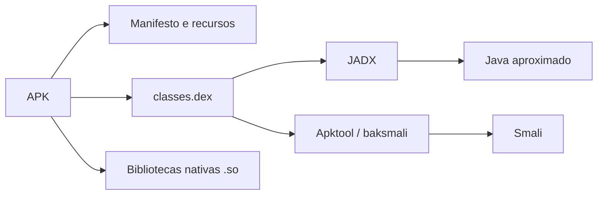
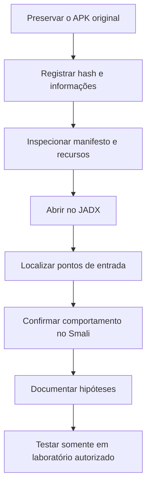

# Java e Smali para Engenharia Reversa de Aplicativos Android

> Guia prático sobre a relação entre Java/Kotlin, DEX, Smali e o Android Runtime na análise estática de aplicativos Android.

[](https://source.android.com/docs/core/runtime)
[](https://developer.android.com/)
[](https://source.android.com/docs/core/runtime/dalvik-bytecode)
[](#uso-responsável)

---

## Sumário

- [Objetivo](#objetivo)
- [Visão geral](#visão-geral)
- [O que existe dentro de um APK](#o-que-existe-dentro-de-um-apk)
- [Java decompilado versus Smali](#java-decompilado-versus-smali)
- [Anatomia de um arquivo Smali](#anatomia-de-um-arquivo-smali)
- [Tipos e assinaturas](#tipos-e-assinaturas)
- [Registradores](#registradores)
- [Instruções essenciais](#instruções-essenciais)
- [Exemplo Java para Smali](#exemplo-java-para-smali)
- [Fluxo de análise estática](#fluxo-de-análise-estática)
- [Laboratório prático](#laboratório-prático)
- [Erros frequentes](#erros-frequentes)
- [Limitações da análise estática](#limitações-da-análise-estática)
- [Roteiro de estudos](#roteiro-de-estudos)
- [Referências](#referências)
- [Uso responsável](#uso-responsável)

---

> [!IMPORTANTE]
> Smali não é uma reprodução do código-fonte original. Ele é uma representação textual das instruções armazenadas no DEX.

## Visão geral

### Construção normal de um aplicativo


### Caminho da análise reversa



Embora Smali seja frequentemente descrito como o “assembly do Dalvik”, o Android moderno utiliza principalmente o **ART**. O ART continua executando o formato DEX e sua especificação de bytecode.

## O que existe dentro de um APK

Um APK é essencialmente um pacote ZIP estruturado:

```text
aplicativo.apk
├── AndroidManifest.xml
├── classes.dex
├── classes2.dex
├── resources.arsc
├── res/
├── assets/
├── lib/
│   ├── arm64-v8a/
│   └── x86_64/
└── META-INF/
```

| Elemento | Função |
|---|---|
| `AndroidManifest.xml` | Declara pacote, permissões, componentes e configurações |
| `classes*.dex` | Contém classes e bytecode executável pelo Android |
| `resources.arsc` | Tabela compilada de recursos |
| `res/` | Layouts, imagens, strings e outros recursos |
| `assets/` | Arquivos incluídos quase sem processamento |
| `lib/` | Código nativo compilado para diferentes arquiteturas |
| `META-INF/` | Metadados relacionados ao pacote e, dependendo do esquema, à assinatura |

Aplicativos grandes podem usar vários arquivos DEX. Ao decodificá-los com Apktool, é comum encontrar:

```text
smali/
smali_classes2/
smali_classes3/
```

## Java decompilado versus Smali

O JADX tenta reconstruir Java legível a partir do DEX. Essa visualização é excelente para compreender rapidamente a lógica, mas não deve ser confundida com o código-fonte original.

| Java decompilado | Smali |
|---|---|
| Mais fácil de ler | Mais próximo do DEX real |
| Reconstrói estruturas de alto nível | Expõe instruções e registradores |
| Pode simplificar incorretamente alguns fluxos | Preserva labels, saltos e chamadas |
| Esconde vários detalhes do bytecode | Exige mais conhecimento técnico |
| Ideal para reconhecimento inicial | Ideal para confirmação detalhada |

### Regra prática

> Use o Java decompilado para descobrir **o que provavelmente está acontecendo** e o Smali para confirmar **como o DEX realmente representa a operação**.

O R8 pode remover código não utilizado, trocar nomes, fazer *inlining* de métodos e fundir classes. Por isso, uma classe originalmente chamada `SessionRepository` pode aparecer como `a.b.c`.

## Anatomia de um arquivo Smali

```smali
.class public Lcom/exemplo/Calculadora;
.super Ljava/lang/Object;

.field private contador:I

.method public constructor <init>()V
    .locals 0

    invoke-direct {p0}, Ljava/lang/Object;-><init>()V
    return-void
.end method
```

| Diretiva | Significado |
|---|---|
| `.class` | Declara a classe atual |
| `.super` | Informa sua superclasse |
| `.implements` | Declara uma interface implementada |
| `.field` | Declara um campo ou atributo |
| `.method` | Inicia a declaração de um método |
| `.locals` | Quantidade de registradores locais |
| `.registers` | Total de registradores do método |
| `.end method` | Encerra o método |

Os nomes de classe usam barras no lugar de pontos e terminam com `;`:

```text
Java:  com.exemplo.Calculadora
Smali: Lcom/exemplo/Calculadora;
```

## Tipos e assinaturas

### Tipos primitivos

| Smali | Java/Kotlin |
|:---:|---|
| `V` | `void` / `Unit` em determinados contextos compilados |
| `Z` | `boolean` |
| `B` | `byte` |
| `S` | `short` |
| `C` | `char` |
| `I` | `int` |
| `J` | `long` |
| `F` | `float` |
| `D` | `double` |

### Objetos e arrays

| Smali | Java |
|---|---|
| `Ljava/lang/String;` | `java.lang.String` |
| `Ljava/util/List;` | `java.util.List` |
| `[I` | `int[]` |
| `[[I` | `int[][]` |
| `[Ljava/lang/String;` | `String[]` |

### Assinaturas de métodos

```smali
.method public somar(II)I
```

Leitura:

```text
somar (I I) I
       │ │  └── retorna int
       └─┴──── recebe dois ints
```

Equivalente aproximado:

```java
public int somar(int primeiro, int segundo)
```

Outro exemplo:

```smali
formatar(Ljava/lang/String;Z)Ljava/lang/String;
```

Equivale aproximadamente a:

```java
String formatar(String texto, boolean ativo)
```

## Registradores

O bytecode DEX usa uma máquina baseada em registradores.

```smali
const/4 v0, 0x2
const/4 v1, 0x3
add-int v2, v0, v1
return v2
```

Representação aproximada:

```java
int v0 = 2;
int v1 = 3;
int v2 = v0 + v1;
return v2;
```

### Registradores `p` e `v`

- `p0`, `p1`, `p2`... representam parâmetros.
- `v0`, `v1`, `v2`... representam registradores locais.
- Em métodos de instância, `p0` normalmente contém `this`.
- Em métodos estáticos, o primeiro argumento começa em `p0`.
- `long` e `double` ocupam pares de registradores.

### `.locals` e `.registers`

```smali
.locals 2
```

Declara dois registradores locais, sem contar os registradores usados pelos parâmetros.

```smali
.registers 4
```

Declara quatro registradores no total, incluindo parâmetros e variáveis locais.

> [!WARNING]
> Aumentar ou reutilizar registradores sem acompanhar seus tipos ao longo de todos os caminhos do método é uma causa comum de `VerifyError`.

## Instruções essenciais

### Constantes e movimentação

```smali
const/4 v0, 0x1
const/16 v1, 0x64
const-string v2, "Olá, Android!"

move v3, v0
move-object v4, v2
move-wide v5, v7
```

### Criação de objetos

```smali
new-instance v0, Ljava/lang/StringBuilder;
invoke-direct {v0}, Ljava/lang/StringBuilder;-><init>()V
```

O padrão é:

1. `new-instance` aloca o objeto;
2. `invoke-direct` chama o construtor `<init>`.

### Chamadas de métodos

```smali
invoke-virtual {v0, p1}, Lcom/exemplo/Usuario;->formatar(Ljava/lang/String;)Ljava/lang/String;
move-result-object v1
```

| Instrução | Uso típico |
|---|---|
| `invoke-static` | Método estático |
| `invoke-virtual` | Método virtual de instância |
| `invoke-direct` | Construtor ou método privado |
| `invoke-super` | Implementação da superclasse |
| `invoke-interface` | Método acessado por uma interface |

Resultados são recuperados com:

```smali
move-result v0
move-result-object v1
move-result-wide v2
```

> [!CAUTION]
> Quando necessário, `move-result*` deve aparecer imediatamente depois de `invoke-*`. Inserir outra instrução entre eles pode invalidar o bytecode.

### Campos de instância e estáticos

```smali
# Campo de instância
iget-object v0, p0, Lcom/exemplo/Tela;->usuario:Lcom/exemplo/Usuario;
iput v1, p0, Lcom/exemplo/Tela;->contador:I

# Campo estático
sget-object v2, Lcom/exemplo/Config;->TAG:Ljava/lang/String;
sput-boolean v3, Lcom/exemplo/Config;->ativo:Z
```

| Prefixo | Operação |
|---|---|
| `iget` | Lê campo de uma instância |
| `iput` | Escreve campo de uma instância |
| `sget` | Lê campo estático |
| `sput` | Escreve campo estático |

### Condições e saltos

```smali
const/16 v0, 0x12
if-lt p1, v0, :menor

const/4 v1, 0x1
goto :fim

:menor
const/4 v1, 0x0

:fim
return v1
```

Instruções frequentes:

| Instrução | Significado aproximado |
|---|---|
| `if-eq` / `if-ne` | Igual / diferente |
| `if-lt` / `if-ge` | Menor / maior ou igual |
| `if-eqz` / `if-nez` | Igual ou diferente de zero/`null` |
| `goto` | Salto incondicional |
| `packed-switch` | `switch` com valores próximos |
| `sparse-switch` | `switch` com valores espaçados |

### Retornos

```smali
return-void
return v0
return-object v1
return-wide v2
```

## Exemplo Java para Smali

### Java

```java
public int dobroSePositivo(int numero) {
    if (numero <= 0) {
        return 0;
    }

    return numero * 2;
}
```

### Smali aproximado

```smali
.method public dobroSePositivo(I)I
    .locals 1

    if-lez p1, :retornar_zero

    mul-int/lit8 v0, p1, 0x2
    return v0

    :retornar_zero
    const/4 v0, 0x0
    return v0
.end method
```

### Leitura passo a passo

1. `(I)I` indica que o método recebe e retorna um `int`.
2. `p0` contém a instância atual.
3. `p1` contém o argumento `numero`.
4. `if-lez` salta quando `numero <= 0`.
5. `mul-int/lit8` multiplica o argumento por `2`.
6. `return v0` devolve o resultado.

## Fluxo de análise estática



### 1. Preserve o original

- trabalhe em uma cópia;
- registre o hash do arquivo;
- mantenha um diário das alterações;
- use um emulador ou aparelho destinado a testes.

Exemplo para registrar o SHA-256 no PowerShell:

```powershell
Get-FileHash .\app-laboratorio.apk -Algorithm SHA256
```

### 2. Faça um inventário

Verifique:

- nome do pacote e versão;
- `minSdk` e `targetSdk`;
- permissões;
- componentes exportados;
- `Activity` inicial;
- `Service`, `Receiver` e `Provider`;
- quantidade de arquivos DEX;
- bibliotecas nativas;
- recursos e arquivos em `assets/`.

### 3. Use JADX e Apktool em conjunto

- **JADX:** reconhecimento rápido e navegação pelo Java reconstruído.
- **Apktool:** manifesto, recursos e Smali.
- **Android Studio:** inspeção de APK e, quando aplicável, depuração com fontes correspondentes.

### 4. Comece pelos pontos de entrada

Procure primeiro por:

- `Application.onCreate()`;
- `Activity.onCreate()`;
- componentes registrados no manifesto;
- callbacks de botões;
- strings exibidas na interface;
- mensagens observadas no Logcat;
- URLs e nomes de endpoints;
- classes citadas em exceções.

Pesquisar uma string visível na tela costuma ser mais eficiente do que começar lendo milhares de classes.

### 5. Reconstrua o fluxo

Para cada método importante, responda:

```text
Quem chama este método?
Quais parâmetros ele recebe?
Quais campos lê ou altera?
Quais outros métodos chama?
Qual valor retorna?
Quais condições mudam o fluxo?
Quais efeitos externos produz?
```

Crie nomes semânticos nas suas anotações:

```text
a.b.c  → SessionRepository
v0     → resposta
v1     → usuarioAtual
p1     → identificador
```

## Laboratório prático

> Execute os comandos abaixo somente em um aplicativo próprio ou deliberadamente vulnerável.

### Ferramentas

- [JADX](https://github.com/skylot/jadx)
- [Apktool](https://apktool.org/)
- Android SDK Build Tools (`zipalign` e `apksigner`)
- ADB
- Android Studio

### Decodificação

```bash
apktool d app-laboratorio.apk -o app_decodificado
```

### Reconstrução

```bash
apktool b app_decodificado -o app_modificado.apk
```

### Alinhamento

```bash
zipalign -p 4 app_modificado.apk app_alinhado.apk
```

### Assinatura

```bash
apksigner sign \
  --ks laboratorio.jks \
  --out app_assinado.apk \
  app_alinhado.apk
```

### Verificação

```bash
apksigner verify --verbose --print-certs app_assinado.apk
```

> [!NOTE]
> O alinhamento deve acontecer antes da assinatura. Alterar o APK depois de assiná-lo invalida sua assinatura.

Um APK recompilado terá certificado diferente do original, a menos que você possua a chave original. Por isso, normalmente não é possível instalá-lo como atualização de uma versão assinada por outra pessoa.

## Erros frequentes

### Bytecode e registradores

- reutilizar um registrador com tipo incompatível;
- esquecer que `p0` representa `this` em métodos de instância;
- declarar poucos registradores;
- confundir `.locals` com `.registers`;
- usar `move` no lugar de `move-object`;
- esquecer que `long` e `double` usam dois registradores;
- separar `invoke-*` de `move-result*`;
- usar um registrador alto em uma instrução que não o suporta;
- esquecer variantes como `/from16` ou `/range`.

### Classes e métodos

- chamar um método com assinatura incorreta;
- trocar `invoke-static`, `invoke-virtual` e `invoke-direct`;
- criar um objeto sem inicializá-lo corretamente;
- alterar labels e quebrar regiões `try/catch`;
- ignorar métodos sintéticos criados pelo Kotlin ou R8.

### Empacotamento e instalação

- reconstruir recursos com dependências de framework ausentes;
- assinar antes de executar `zipalign`;
- modificar o APK depois da assinatura;
- tentar atualizar um aplicativo assinado com outro certificado;
- analisar somente `smali/` e esquecer `smali_classes2/` ou posteriores.

Erros resultantes podem incluir:

```text
VerifyError
ClassNotFoundException
NoSuchMethodError
INSTALL_FAILED_UPDATE_INCOMPATIBLE
Fechamento imediato do aplicativo
```

## Limitações da análise estática

A leitura de Java e Smali pode não revelar todo o comportamento quando o aplicativo utiliza:

- código nativo em bibliotecas `.so`;
- reflexão;
- carregamento dinâmico de DEX;
- código ou configuração recebidos do servidor;
- WebView e JavaScript;
- strings cifradas ou construídas em tempo de execução;
- ofuscação avançada;
- verificações de integridade;
- *split APKs* e Android App Bundles;
- Jetpack Compose;
- corrotinas e classes sintéticas do Kotlin.

Nesses casos, a análise estática produz hipóteses que devem ser confirmadas com observação dinâmica em ambiente autorizado.

## Folha de consulta rápida

```text
Classe             Lcom/exemplo/MinhaClasse;
Objeto             Ljava/lang/String;
Array de objetos   [Ljava/lang/String;
Array de inteiros  [I
void               V
boolean            Z
int                I
long               J

p0                 this, em método de instância
p1...               parâmetros seguintes
v0...               registradores locais

iget / iput         campos de instância
sget / sput         campos estáticos
invoke-static       método estático
invoke-virtual      método virtual
invoke-direct       construtor ou método privado
move-result-object  recebe resultado de objeto
if-eqz              salta se for zero ou null
goto                salto incondicional
return-void         retorna sem valor
```

## Referências

- [Vídeo-base — Hack N' Roll Academy](https://www.youtube.com/watch?v=Qva0blKn_0Y)
- [Android Runtime e Dalvik](https://source.android.com/docs/core/runtime)
- [Formato do bytecode Dalvik](https://source.android.com/docs/core/runtime/dalvik-bytecode)
- [Formato de arquivos DEX](https://source.android.com/docs/core/runtime/dex-format)
- [Formatos das instruções DEX](https://source.android.com/docs/core/runtime/instruction-formats)
- [Inspeção de APKs no Android Studio](https://developer.android.com/studio/profile/apk-profiler)
- [Otimização e ofuscação com R8](https://developer.android.com/topic/performance/app-optimization/enable-app-optimization)
- [Documentação do Apktool](https://apktool.org/docs/)
- [Documentação do `apksigner`](https://developer.android.com/tools/apksigner)
- [Projeto Smali/baksmali mantido pelo Google](https://github.com/google/smali)
- [JADX](https://github.com/skylot/jadx)

---

## Conclusão

> **Java decompilado mostra a intenção provável do programa; Smali mostra, com muito mais fidelidade, as operações registradas no DEX. Uma análise Android eficiente utiliza as duas visões, começa pelo manifesto e pelos pontos de entrada e valida cada hipótese em ambiente controlado.**

